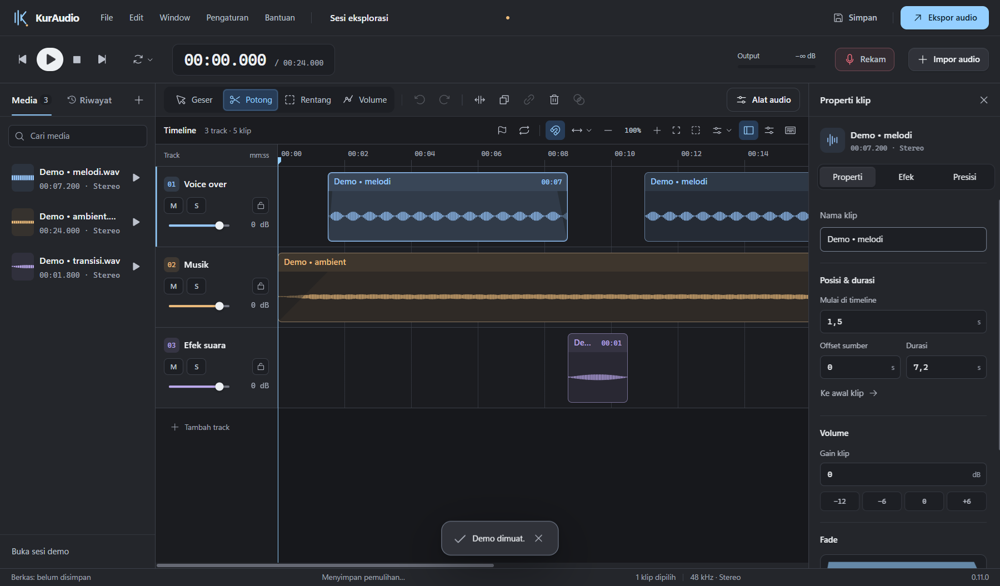

<div align="center">

# KurAudio

**Potong, susun, dan ekspor audio dalam satu timeline.**

Editor audio desktop berbahasa Indonesia untuk Windows.
Audio diproses di komputer sendiri, tanpa akun atau unggah ke cloud.

[Unduh untuk Windows](https://github.com/kuro-usagi-labs/KurAudio/releases/latest) · [Panduan penggunaan](docs/GUIDE.md) · [Laporkan masalah](https://github.com/kuro-usagi-labs/KurAudio/issues)

</div>



KurAudio dibuat untuk menyunting voice-over, menyusun musik latar, dan merapikan rekaman pendek. Geser klip seperti di editor video, rapikan jeda, atur efek, lalu simpan proyek atau ekspor hasilnya.

## Unduh dan mulai

Rilis saat ini: **0.11.0 — Windows 10/11 x64**. Platform lain belum disediakan.

| Pilihan | Unduhan | Cara pakai |
| --- | --- | --- |
| Installer | [KurAudio-0.11.0-x64-setup.exe](https://github.com/kuro-usagi-labs/KurAudio/releases/download/v0.11.0/KurAudio-0.11.0-x64-setup.exe) | Jalankan installer, lalu buka KurAudio. |
| Portable | [KurAudio-0.11.0-windows.zip](https://github.com/kuro-usagi-labs/KurAudio/releases/download/v0.11.0/KurAudio-0.11.0-windows.zip) | Ekstrak seluruh isi ZIP, lalu jalankan `KurAudio.exe`. |

Microsoft Edge WebView2 Runtime diperlukan. Installer dapat mengunduh runtime jika belum terpasang; tahap ini memerlukan internet. Aplikasi tidak memerlukan Node.js, Rust, atau FFmpeg untuk digunakan.

**Rilis belum ditandatangani sertifikat penerbit**, sehingga Windows dapat menampilkan peringatan SmartScreen. Unduh dari halaman Releases resmi. [Checksum SHA-256](https://github.com/kuro-usagi-labs/KurAudio/releases/download/v0.11.0/SHA256SUMS.txt) tersedia untuk memeriksa integritas unduhan.

1. Jatuhkan audio ke beranda, atau buat proyek baru dan pilih **Impor audio**.
2. Geser klip di timeline. Tarik tepinya untuk trim, tekan **S** untuk memotong di playhead.
3. Atur level dan efek, lalu tekan **Space** untuk mendengarkan.
4. **Ctrl+S** menyimpan proyek `.kura` beserta media. **Ctrl+E** mengekspor audio.

Belum punya rekaman untuk dicoba? Pilih **Buka sesi demo** di editor.

## Yang bisa dikerjakan

- **Edit multi-track:** potong, trim, sambung, duplikat, ripple, grup, dan kunci klip.
- **Rapikan rekaman:** seleksi rentang, pangkas hening dengan preview, fade, dan crossfade otomatis.
- **Olah suara:** denoise, EQ bass/treble, compressor, reverb, room, echo, serta preset per klip.
- **Atur level:** mixer track, mute/solo, automation volume, serta pengukuran LUFS dan true peak.
- **Rekam dan dengarkan:** input mikrofon, preview media, marker, loop, dan audisi seleksi.
- **Simpan pekerjaan:** proyek portabel, Undo/Redo, recovery, dan cadangan versi lokal.
- **Ekspor WAV atau MP3:** seluruh proyek, klip terpilih, atau rentang; 44,1/48 kHz.
- **Sesuaikan workspace:** tema terang, gelap, atau mengikuti Windows; panel dan tinggi track dapat diatur.

WAV tersedia dalam PCM 16/24-bit. MP3 memakai CBR 128/192/256/320 kbps. Dukungan impor bergantung pada format dan codec audio; lihat [panduan format](docs/GUIDE.md#format-dan-batas).

## Batas yang perlu diketahui

KurAudio menyimpan audio yang didekode di RAM dan ditujukan untuk sesi pendek.

| Batas | Nilai |
| --- | --- |
| Impor per berkas | 100 MB |
| Total audio decoded | 256 MB |
| Berkas proyek | 400 MB |
| Ekspor, loop, dan rekaman | Maksimal 15 menit; rekaman juga mengikuti sisa memori |

Denoise membantu mengurangi noise konstan, bukan memisahkan vokal atau menghapus semua suara latar. Cadangan lokal tidak menggantikan berkas proyek; simpan `.kura` untuk arsip. Perilaku mikrofon fisik dan scaling Windows dapat berbeda antarperangkat.

## Menjalankan dari source

Stack: **React 19 · TypeScript · Vite · Tauri 2 · Rust**. `package-lock.json` dan `src-tauri/Cargo.lock` mengunci versi dependency.

Untuk frontend, gunakan Node.js **22.12+** dan npm:

```sh
npm ci
npm run dev
```

Buka `http://127.0.0.1:1422`. Mode browser berguna untuk pengembangan UI; integrasi berkas dan jendela desktop memerlukan Tauri.

Untuk desktop Windows, pasang Rust stable dengan toolchain MSVC, Visual Studio Build Tools dengan **Desktop development with C++** dan Windows SDK, serta WebView2. Jalankan dari Developer PowerShell agar compiler dan SDK tersedia:

```powershell
npm ci
npm run tauri -- dev
```

Membangun installer Windows x64:

```powershell
npm run package:source
npm run tauri -- build --bundles nsis -- --jobs 2 --locked
```

Jalankan `package:source` sebelum build agar resource source/relinking LAME tersedia. Installer dihasilkan di `src-tauri/target/release/bundle/nsis/`. Folder `third-party` berisi source library dan teks lisensi yang harus tetap ikut distribusi.

## Pengujian

```sh
npm test
npm run build
```

Tes antarmuka memerlukan Chromium Playwright dan dev server yang berjalan:

```sh
npx playwright install chromium
npm run dev
# Di terminal lain:
npm run test:ui
```

Suite tambahan tersedia di `package.json`. Tes native membutuhkan executable Windows dan beberapa suite membutuhkan profil QA terpisah; jangan menjalankannya terhadap sesi kerja yang sedang dipakai. [Catatan pengujian 0.11.0](docs/AUDIT-0.11.0.md) memuat cakupan dan keterbatasan pengujian rilis lokal. [Catatan publikasi](docs/PUBLISHING.md) menjelaskan pemisahan source dan artefak rilis.

## Melaporkan masalah

Buka [issue](https://github.com/kuro-usagi-labs/KurAudio/issues) dengan versi KurAudio, versi Windows, langkah untuk mengulang masalah, dan hasil yang diharapkan. Sertakan format/durasi audio bila relevan. Gunakan contoh sintetis atau audio yang boleh dibagikan; jangan sertakan rekaman pribadi.

## Lisensi dan dependency

Kode KurAudio dilisensikan di bawah [MIT License](LICENSE). Kamu dapat menggunakan, memodifikasi, dan mendistribusikannya, termasuk untuk keperluan komersial, dengan menyertakan pemberitahuan hak cipta dan lisensinya.

Dependency tetap mengikuti lisensi masing-masing. Encoder MP3 memakai **LAME / @breezystack/lamejs 1.2.7 (LGPL-3.0)**. Teks lisensi, source library, dan petunjuk relinking tersedia di [third-party/lamejs](third-party/lamejs). Distribusi Windows menyertakan `THIRD-PARTY.txt` dan arsip source aplikasi untuk keperluan build ulang/relinking.
